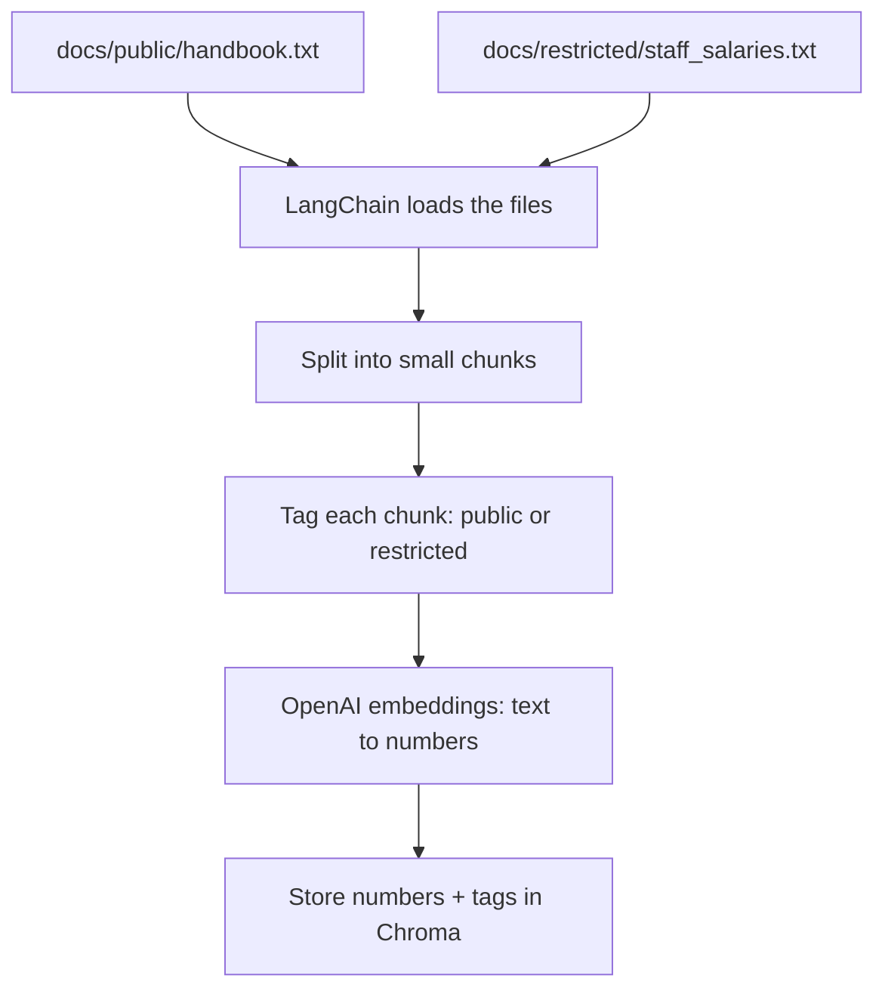
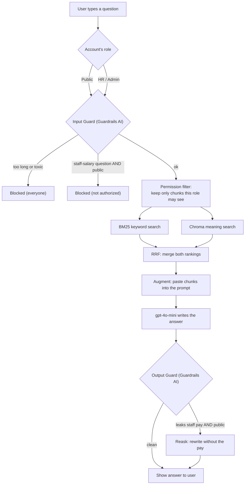
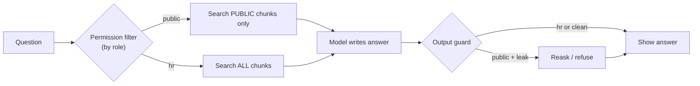

# 🏗️ Chat With Your Notes — Architecture (Simple Version)

A plain-language map of how the whole app works and what tech does each job.
If you can read this, you can explain the app to anyone.

---

## 🧠 The big idea in one line
> You give it documents. You ask questions. It finds the right piece of your
> documents and the AI answers from it — **safely**, and **only what you're
> allowed to see**.

---

## 🔧 The tech, and the one job each does

| Tool | Its one job | Plain-English name |
|---|---|---|
| **React + FastAPI** | The chat website you type into, and its API | The front desk |
| **Sign-in** (password, Google, Microsoft) | Proves who you are; your account sets your role | The badge at the door |
| **LangChain** | Connects all the steps together | The recipe / glue |
| **OpenAI `text-embedding-3-small`** | Turns text into numbers (meaning) | The translator |
| **Chroma** | Stores those numbers + searches them | The librarian |
| **BM25** | Keyword search (exact words) | The index at the back of a book |
| **RRF** | Merges keyword + meaning results | The judge that ranks both |
| **OpenAI `gpt-4o-mini`** | Writes the final answer | The writer |
| **Guardrails AI** | Safety checks on input & output | The security guard |
| **Permission filter** | Decides which docs you may search | The keycard / access control |

**Everything is free except the two OpenAI models** (a few cents to run).

---

## 📦 PHASE 1 — Ingest (run once: "studying the documents")

```
  docs/public/handbook.txt          docs/restricted/staff_salaries.txt
        │                                      │
        └──────────────┬───────────────────────┘
                       ▼
              [ LangChain loads files ]
                       │
                       ▼
              [ Split into small chunks ]        ← RecursiveCharacterTextSplitter
                       │
                       ▼
        [ TAG each chunk: public or restricted ] ← permission metadata
                       │
                       ▼
     [ OpenAI embeddings: text → numbers ]       ← text-embedding-3-small
                       │
                       ▼
        [ Store numbers + tags in Chroma ]       ← chroma_db/ folder
```
**Result:** a searchable database where every chunk knows (a) its meaning-numbers
and (b) who is allowed to see it.

---

## 💬 PHASE 2 — Ask a question (runs every time)

```
                    ┌─────────────────────────────────────┐
   You type  ─────► │  Chat website  +  you, signed in     │   role = from your account
   a question       └──────────────────┬──────────────────┘
                                       ▼
                    ┌──────────────────────────────────────┐
                    │  GUARD 1 — INPUT (Guardrails AI)      │
                    │  • too long? toxic?  → block (anyone) │
                    │  • about staff salary? → block        │
                    │       (ONLY if you're 'public')       │
                    └──────────────────┬───────────────────┘
                                       │ passes
                                       ▼
                    ┌──────────────────────────────────────┐
                    │  RETRIEVE — search YOUR allowed docs  │
                    │                                       │
                    │   ┌── BM25 keyword search ──┐         │
                    │   │                          ├─ RRF ──┼──► best chunks
                    │   └── Chroma meaning search ─┘         │
                    │                                       │
                    │   🔑 permission filter: a 'public'    │
                    │      user only ever searches PUBLIC   │
                    │      chunks — the salary chunk is      │
                    │      NEVER fetched for them.           │
                    └──────────────────┬───────────────────┘
                                       ▼
                    ┌──────────────────────────────────────┐
                    │  AUGMENT — paste chunks into a prompt │  ← LangChain template
                    └──────────────────┬───────────────────┘
                                       ▼
                    ┌──────────────────────────────────────┐
                    │  GENERATE — AI writes the answer      │  ← gpt-4o-mini
                    └──────────────────┬───────────────────┘
                                       ▼
                    ┌──────────────────────────────────────┐
                    │  GUARD 2 — OUTPUT (Guardrails AI)     │
                    │  • does the answer leak staff pay?    │
                    │       (ONLY checked if 'public')      │
                    │  • if leak → REASK: rewrite without it│
                    └──────────────────┬───────────────────┘
                                       ▼
                              Answer shown to you
```
To answer sooner, GUARD 1 (and the prompt-injection check) actually runs at the
same time as RETRIEVE. GENERATE waits for it, and nothing retrieved is shown or
put in a prompt until it passes — a blocked question gets the same refusal.
Each question keeps its own state, so people asking at once don't wait for
each other.

**One answer, cited.** The search hands the model numbered passages (S1, S2, …,
each its own spotlighted block), and ONE model call writes the answer, putting
`[S1]` after what it took from each. The server keeps only markers that point at a
passage read for this question that the asker may see, renumbers them in order of
first use, and lists those passages under the answer, where each opens at the
cited span (`GET /api/passages/{chunk_id}`, checked against the role every time).
Every chunk carries what that needs: `chunk_id`, `doc_id`, title, provider, link,
access, `modified`, `char_start`/`char_end`, PDF page and heading path (ingest.py).

---

## 🔐 The two safety layers (don't mix them up)

```
LAYER 1 — PERMISSION FILTER   "the wall"
   Decides WHICH documents you can search, based on your role.
   Public user can't even look in the salary file.
   → The model can't leak what it never received.

LAYER 2 — GUARDRAILS          "the backup net"
   • Generic checks (too long / toxic)  → apply to EVERYONE
   • Salary checks (input + output)      → apply to PUBLIC only (HR skips them)
   • If a leak slips through             → REASK rewrites it cleanly
```

The question is screened for prompt injection, but documents can carry planted
instructions too (anyone who can edit a synced doc or wiki page). `untrusted.py`
handles that, for every role:
- **Spotlighting.** Every chunk and tool result reaches a model inside an
  `<untrusted_data source="...">` block, and the system prompts say text in a block
  is data, never instructions. Text that imitates the delimiter is defused first.
- **Egress.** Wikipedia and currency calls whose arguments quote 40+ letters/digits
  of text retrieved for the same question are refused. `ALLOW_WIKIPEDIA` /
  `ALLOW_CURRENCY` (on by default) remove those tools altogether.
- **Links.** Links in an answer that appear in neither the sources read nor the
  question become plain text (and are logged). The chat view never loads images.
- **Red team.** `eval/redteam.py` plants such instructions (`eval/corpus_redteam/`);
  `tests/test_injection.py` runs it with a model that obeys them, and
  `python evaluate.py --redteam` with the real one.

---

## 🔑 Where your role comes from

```
  Sign in ──► password account ──► allowed unless the workspace requires single sign-on
          │                        (admins always keep theirs)
          └─► single sign-on: Google / Microsoft, or the workspace's own Okta / Entra /
              SAML provider ──► sso.py checks the database (members_store.py):
                                 • is your email's domain verified by this workspace?
                                   no → turned away
                                 • your role, in this order:
                                     access turned off           → no access
                                     a role an admin set          → that role
                                     your groups at the provider  → the highest rule
                                     otherwise                    → public
```
`admin` is HR plus control over who may sign in (the **Access** screen); the
app treats both as HR / Admin. Groups are read at each sign-in through the
workspace's **role source** (the one provider with group rules); signing in
through another provider leaves the role alone. Admin from groups the role
source hasn't sent in 30 days (configurable) expires, except for the last admin.
Your role is looked up again on **every request**, so taking someone's HR role
away works straight away. The website can *lower* it (an HR user can "view as
public"), but it can never *raise* it — the server decides.

---

## 👤 Same question, two roles (the whole point)

```
"What is the teacher salary?"

  PUBLIC user                         HR / ADMIN user
  ───────────                         ───────────────
  input guard: about pay? YES         input guard: SKIPPED (authorized)
        → BLOCKED 🚫                   retrieve: searches BOTH rooms
                                       finds salary chunk
                                       AI answers "60,000 rupees" ✅
```

---

## 🗺️ Which roadmap phase each part covers

| Part of the app | Roadmap phase |
|---|---|
| Embeddings + Chroma | Phase 2 — Embeddings & Vector DB |
| Chunking, retrieve, BM25, RRF, hybrid | Phase 3 — RAG |
| LangChain loaders / splitters / prompts | Phase 4 — Frameworks |
| Guardrails + permission filtering | Phase 6 — Production safety |
| Sign-in (SSO) + account roles | Phase 6 — Production safety |

---

## 🗣️ Say this out loud and you've explained the whole app
> "Documents are split into chunks, turned into meaning-numbers by an embedding
> model, and stored in Chroma with a tag for who can see them. When you ask a
> question, a guard checks it, then the app searches **only the chunks you're
> allowed to see** — using both keyword and meaning search, merged with RRF. The
> best chunks go to gpt-4o-mini, which writes the answer. A final guard checks the
> answer for leaks and rewrites it if needed. That whole pattern is **secure RAG**."

---

## 🔁 Re-indexing and background jobs

Work that shouldn't hold up a request runs as a **job**: a row in the `jobs`
table that a pool of worker threads claims, runs and marks done (`kb/jobs.py`).
Re-indexing a workspace, syncing a connector, and the periodic connector sync,
SAML metadata refresh and clean-up are all jobs. A claim is a lease in the
database, so a job survives a restart (another worker takes it over when the
lease runs out), a failed job is retried with a growing wait, and each lane runs
one job at a time: one index run per workspace, while workspaces take turns
and never wait on each other. The workers run inside the API, or as
`python -m kb.worker` (deploy.md, "Background jobs").

```
  upload / edit / delete ──► index job (that document)     ┐
  connector sync changed ──► index job (those documents)   ├─► ingest.update: only what changed
  "Re-index"             ──► index job                     ┘     is embedded; deleted files'
  access level changed   ──► retag job ─► chunks' access tag      chunks are removed
                                          updated, no embedding
  "Rebuild everything",  ──► index job ─► ingest.main into a NEW collection, then the
  new chunking settings                   workspace switches to it (search_indexes)
```

Every chunk has a **stable id** from (workspace, document, chunk number, chunk
text), and carries its document's key, a hash of its content and its access
level, so a run can tell what's new, changed or gone without embedding anything
it already has. Questions are answered throughout: an update changes the index
a document at a time, and a full rebuild builds beside the collection in use,
which answers until the switch (a failed rebuild leaves it in place). Each
workspace's row in `search_indexes` names its collection and a version that
changes with every update; agents reload when it does (`kb/services/agents.py`).

---

## 🗄️ Database migrations

Accounts, sign-in providers, sessions and integrations live in one SQLite file,
`config/app.db` (`APP_DB`). `db.py` is the only place it's found and opened
(WAL mode, a 5 s busy timeout, `foreign_keys = ON`, `sqlite3.Row` rows); the
stores use plain `sqlite3`. Its schema is kept by **Alembic** migrations in
`migrations/versions/`, numbered `0001`, `0002`, ….

**How a database gets upgraded.** The first `db.connect()` in a process runs
every migration the file doesn't have yet, in one transaction (`BEGIN IMMEDIATE`:
all or nothing, and a second worker starting at the same moment waits, then finds
nothing to do). A database made before Alembic (app tables, no `alembic_version`)
is first brought to the baseline by `migrations/legacy.py`, the old stores' own
add-a-column and data-fix steps, frozen, then marked as at `0001`. Nothing to do
by hand on deploy: the new image upgrades `config/app.db` on its first request.
`alembic upgrade head` (in the repo root, or `docker compose exec knowledgebase
alembic upgrade head`) does the same on demand; `alembic current` shows where a
database is. Back up first (`scripts/backup.sh`): there's no automatic way down.

**Adding a migration.**

1. `alembic revision -m "add members.locale" --rev-id 0002` (next number) makes
   `migrations/versions/0002_add_members_locale.py`.
2. Write `upgrade()` with `op.add_column`, `op.create_table`, `op.create_index`,
   or raw SQL through `op.get_bind().exec_driver_sql(...)`. To change a column or
   a CHECK, which SQLite can't do in place, use `with op.batch_alter_table("t") as b:`
   (it copies the table; foreign keys are off while migrating, so the copy doesn't
   cascade-delete anything, and the upgrade is undone if it leaves a dangling
   reference). Fill new columns from old data in the same migration.
3. Never edit a migration that has been merged, and never edit
   `migrations/legacy.py` or `0001_baseline.py`: databases already ran them.
4. Keep it **expand / contract**: add the new column or table and start writing
   it; switch reads in a later release; drop the old one later still. The previous
   release must keep working on the upgraded schema, so a rollback is just
   deploying the old image.
5. Test it: `tests/test_migrations.py` upgrades an empty database and every
   pre-Alembic fixture in `tests/fixtures/legacy_dbs/` to the newest migration and
   checks every row survives and the schema matches a new database's. Add a test
   for your data change there.

---

## 📊 Mermaid diagrams (render in GitHub / VS Code preview)

> To view: open this file's **Markdown Preview** in VS Code (Ctrl+Shift+V).
> If diagrams don't render, install the "Markdown Preview Mermaid Support" extension.

### Diagram 1 — Ingest (run once)



### Diagram 2 — Asking a question (every time)



### Diagram 3 — The two safety layers (zoomed in)



