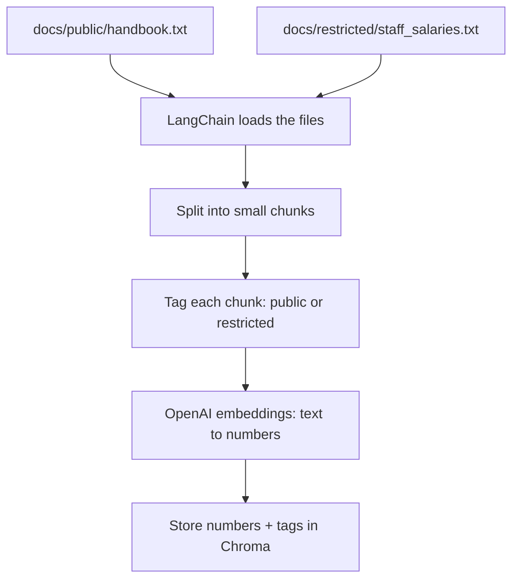
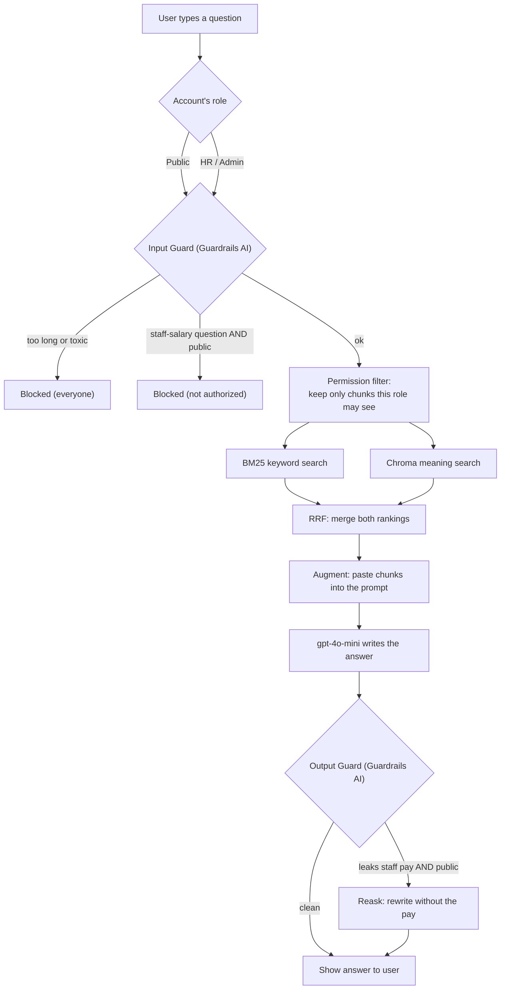
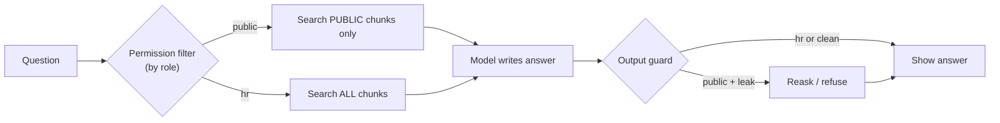

# 🏗️ Chat With Your Notes — Architecture (Simple Version)

A plain-language map of how the whole app works and what tech does each job.
If you can read this, you can explain the app to anyone.

---

## 🧠 The big idea in one line
> You give it documents. You ask questions. It finds the right piece of your
> documents and the AI answers from it — **safely**, and **only what you're
> allowed to see**.

---

## 🔧 The tech, and the one job each does

| Tool | Its one job | Plain-English name |
|---|---|---|
| **React + FastAPI** | The chat website you type into, and its API | The front desk |
| **Sign-in** (password, Google, Microsoft) | Proves who you are; your account sets your role | The badge at the door |
| **LangChain** | Connects all the steps together | The recipe / glue |
| **OpenAI `text-embedding-3-small`** | Turns text into numbers (meaning) | The translator |
| **Chroma** | Stores those numbers + searches them | The librarian |
| **BM25** | Keyword search (exact words) | The index at the back of a book |
| **RRF** | Merges keyword + meaning results | The judge that ranks both |
| **OpenAI `gpt-4o-mini`** | Writes the final answer (ANSWER_MODEL; small jobs on FAST_MODEL, models.py) | The writer |
| **AWS Bedrock** (optional) | Every model above instead of OpenAI, in the company's own AWS account: `MODEL_PROVIDER=bedrock`, or one workspace's "Bring your own AWS" (models.py, deploy.md "AWS Bedrock"). Chat and embeddings can be on different providers (`CHAT_PROVIDER`, `EMBED_PROVIDER`, models.py's REGISTRY; deploy.md "Model providers"), e.g. Claude through Anthropic's API for chat (`CHAT_PROVIDER=anthropic`; deploy.md "Anthropic") | The in-house translator and writer |
| **Guardrails AI** | Safety checks on input & output | The security guard |
| **Permission filter** | Decides which docs you may search | The keycard / access control |

**Everything is free except the two OpenAI models** (a few cents to run).

---

## 📦 PHASE 1 — Ingest (run once: "studying the documents")

```
  docs/public/handbook.txt          docs/restricted/staff_salaries.txt
        │                                      │
        └──────────────┬───────────────────────┘
                       ▼
              [ LangChain loads files ]
                       │
                       ▼
              [ Split into chunks by structure ]  ← chunking.py: headings, table rows, code, pages
                       │
                       ▼
        [ TAG each chunk: public or restricted ] ← permission metadata
                       │
                       ▼
     [ OpenAI embeddings: text → numbers ]       ← text-embedding-3-small
                       │
                       ▼
        [ Store numbers + tags in Chroma ]       ← chroma_db/ folder
```
**Result:** a searchable database where every chunk knows (a) its meaning-numbers
and (b) who is allowed to see it.

---

## 💬 PHASE 2 — Ask a question (runs every time)

```
                    ┌─────────────────────────────────────┐
   You type  ─────► │  Chat website  +  you, signed in     │   role = from your account
   a question       └──────────────────┬──────────────────┘
                                       ▼
                    ┌──────────────────────────────────────┐
                    │  GUARD 1 — INPUT (Guardrails AI)      │
                    │  • too long? toxic?  → block (anyone) │
                    │  • about staff salary? → block        │
                    │       (ONLY if you're 'public')       │
                    └──────────────────┬───────────────────┘
                                       │ passes
                                       ▼
                    ┌──────────────────────────────────────┐
                    │  RETRIEVE — search YOUR allowed docs  │
                    │                                       │
                    │   ┌── BM25 keyword search ──┐         │
                    │   │                          ├─ RRF ──┼──► best chunks
                    │   └── Chroma meaning search ─┘         │
                    │   (+ optional reranker: rerankers.py)  │
                    │                                       │
                    │   🔑 permission filter: a 'public'    │
                    │      user only ever searches PUBLIC   │
                    │      chunks — the salary chunk is      │
                    │      NEVER fetched for them.           │
                    └──────────────────┬───────────────────┘
                                       ▼
                    ┌──────────────────────────────────────┐
                    │  AUGMENT — paste chunks into a prompt │  ← LangChain template
                    └──────────────────┬───────────────────┘
                                       ▼
                    ┌──────────────────────────────────────┐
                    │  GENERATE — AI writes the answer      │  ← gpt-4o-mini
                    └──────────────────┬───────────────────┘
                                       ▼
                    ┌──────────────────────────────────────┐
                    │  GUARD 2 — OUTPUT (Guardrails AI)     │
                    │  • does the answer leak staff pay?    │
                    │       (ONLY checked if 'public')      │
                    │  • if leak → REASK: rewrite without it│
                    └──────────────────┬───────────────────┘
                                       ▼
                              Answer shown to you
```
To answer sooner, GUARD 1 (and the prompt-injection check) actually runs at the
same time as RETRIEVE. GENERATE waits for it, and nothing retrieved is shown or
put in a prompt until it passes — a blocked question gets the same refusal.
Each question keeps its own state, so people asking at once don't wait for
each other.

**One answer, cited.** The search hands the model numbered passages (S1, S2, …,
each its own spotlighted block), and ONE model call writes the answer, putting
`[S1]` after what it took from each. The server keeps only markers that point at a
passage read for this question that the asker may see, renumbers them in order of
first use, and lists those passages under the answer, where each opens at the
cited span (`GET /api/passages/{chunk_id}`, checked against the role every time).
Every chunk carries what that needs: `chunk_id`, `doc_id`, title, provider, link,
access, `modified`, `char_start`/`char_end`, PDF page and heading path (ingest.py).

---

## 🔐 The two safety layers (don't mix them up)

```
LAYER 1 — PERMISSION FILTER   "the wall"
   Decides WHICH documents you can search, based on your role.
   Public user can't even look in the salary file.
   → The model can't leak what it never received.

LAYER 2 — GUARDRAILS          "the backup net"
   • Generic checks (too long / toxic)  → apply to EVERYONE
   • Salary checks (input + output)      → apply to PUBLIC only (HR skips them)
   • If a leak slips through             → REASK rewrites it cleanly
```

The question is screened for prompt injection, but documents can carry planted
instructions too (anyone who can edit a synced doc or wiki page). `untrusted.py`
handles that, for every role:
- **Spotlighting.** Every chunk and tool result reaches a model inside an
  `<untrusted_data source="...">` block, and the system prompts say text in a block
  is data, never instructions. Text that imitates the delimiter is defused first.
- **Egress.** Wikipedia and currency calls whose arguments quote 40+ letters/digits
  of text retrieved for the same question are refused. `ALLOW_WIKIPEDIA` /
  `ALLOW_CURRENCY` (on by default) remove those tools altogether.
- **Links.** Links in an answer that appear in neither the sources read nor the
  question become plain text (and are logged). The chat view never loads images.
- **Red team.** `eval/redteam.py` plants such instructions (`eval/corpus_redteam/`);
  `tests/test_injection.py` runs it with a model that obeys them, and
  `python evaluate.py --redteam` with the real one.

---

## 🔑 Where your role comes from

```
  Sign in ──► password account ──► allowed unless the workspace requires single sign-on
          │                        (admins always keep theirs)
          └─► single sign-on: Google / Microsoft, or the workspace's own Okta / Entra /
              SAML provider ──► sso.py checks the database (members_store.py):
                                 • is your email's domain verified by this workspace?
                                   no → turned away
                                 • your role, in this order:
                                     access turned off           → no access
                                     a role an admin set          → that role
                                     your groups at the provider  → the highest rule
                                     otherwise                    → public
```
`admin` is HR plus control over who may sign in (the **Access** screen); the
app treats both as HR / Admin. Groups are read at each sign-in through the
workspace's **role source** (the one provider with group rules); signing in
through another provider leaves the role alone. Admin from groups the role
source hasn't sent in 30 days (configurable) expires, except for the last admin.
Your role is looked up again on **every request**, so taking someone's HR role
away works straight away. The website can *lower* it (an HR user can "view as
public"), but it can never *raise* it — the server decides.

---

## 🧑‍🤝‍🧑 Groups and per-document permissions

Roles (public, hr, admin) gate **screens**. **Access groups** gate **content**
(`access.py`, `groups_store.py`, platform.md PL-09):

```
  every chunk ── acl: [principals that may read it]
                   everyone · user:<email> · group:<id> · domain:<verified domain>
                   (nobody: nothing it was shared with matched anyone here)

  every request ── the asker's principals, looked up now:
                   everyone + user:<them> + their groups + group:hr (HR / Admin)
                   + domain:<their email's domain, if the workspace verified it>

  search keeps a chunk only if its acl ∩ the asker's principals ≠ ∅
     dense:  Chroma `where {"$or": [{"acl": {"$contains": p}}, ...]}` (chromadb 1.5.9)
     BM25:   built ONCE per index version, filtered as it ranks (rag.KeywordIndex)
```
- **The old levels are ACLs.** `public` is `[everyone]`, `restricted` is the
  built-in group `hr`, whose members are everyone whose role is HR or Admin. With
  no groups or picks, nothing behaves differently. Chunks indexed before ACLs get
  their level's the first time they're searched (`ingest.backfill_acls`).
- **Groups.** Manual (Access → Groups), or copies of the identity provider's:
  `idp` from sign-in group claims, `scim` from SCIM pushes (read-only here).
- **Uploads.** The Documents screen's picker: everyone, or any groups and people.
  Changing it re-tags the chunks; nothing is embedded again.
- **Synced files** follow their connection's **permission policy**:
  `restricted` (HR and admins, the default), `workspace` (everyone), or `source`:
  each file for who may read it at the source (`source_items.acl`), mapped by
  `kb/services/permissions.py` to members (emails), identity-provider groups (by
  email, name or id) and verified domains. **A grant that matches nothing here is
  dropped, never widened**; a file with nothing left is for no one. Jira issues
  with a security level, unreadable Confluence restrictions and similar fail
  closed. Zendesk and Freshdesk tickets and Intercom conversations lock their
  connection to `restricted`. Newer connectors tag their acl with `via`
  (`linear`, `dropbox`, `box`, `s3`, `freshdesk`, `hubspot`, `intercom`,
  `salesforce`, `asana`, `clickup`, `coda`, `teams`) and each has its own
  mapping; an unknown `via` is for no one. S3 has no source permissions at all,
  and Intercom's API doesn't expose article audiences, so their connections can't
  pick `source`; Coda offers it only once every picked doc's sharing was readable.
  Teams channel messages are locked to `restricted` until an admin lets members
  ask. Help-desk and CRM knowledge bases map only provably public articles to
  everyone; anything narrower is the hr group.
- **Personal connections** (Gmail, Google Calendar: `kb/routers/my_integrations.py`)
  are each member's own, keyed `<provider>~<hash of their username>`: every file
  carries `user:<them>` whatever a policy says (`permissions.personal_acl`), no
  admin endpoint reaches them (`registry.get` never returns one), and the
  knowledge listing, Insights, digests, webhooks, the question log and billing
  skip them. Removing, erasing or purging revokes and deletes them.
- **ACL drift.** Sharing is read at every sync (every 30 minutes): after each one
  a source-policy connection is re-tagged (only chunks whose ACL changed). A
  change at the source, or a new group member here, can take until the next sync;
  **Sync permissions now** on the card does it at once.
- **Answers.** An answer's audience is every ACL the model read for it
  (`messages.acl`, a list of ACLs; a reader must hold a principal of each). Chats,
  share links (the viewer AND the sharer must qualify), chat search, Copy / export,
  feedback review, the API, MCP and verified answers all check it on every read.
  A Slack channel is answered as `everyone` only.
- **Staff pay.** The salary guardrails are skipped only for holders of the `hr`
  group (`safety.may_see_restricted`): by default HR and Admin, as before.
- Password accounts whose username isn't an email only ever match grants made
  here (groups, picks), never a source's user grants.

---

## 👤 Same question, two roles (the whole point)

```
"What is the teacher salary?"

  PUBLIC user                         HR / ADMIN user
  ───────────                         ───────────────
  input guard: about pay? YES         input guard: SKIPPED (authorized)
        → BLOCKED 🚫                   retrieve: searches BOTH rooms
                                       finds salary chunk
                                       AI answers "60,000 rupees" ✅
```

---

## 🗺️ Which roadmap phase each part covers

| Part of the app | Roadmap phase |
|---|---|
| Embeddings + Chroma | Phase 2 — Embeddings & Vector DB |
| Chunking, retrieve, BM25, RRF, hybrid | Phase 3 — RAG |
| LangChain loaders / splitters / prompts | Phase 4 — Frameworks |
| Guardrails + permission filtering | Phase 6 — Production safety |
| Sign-in (SSO) + account roles | Phase 6 — Production safety |

---

## 🗣️ Say this out loud and you've explained the whole app
> "Documents are split into chunks, turned into meaning-numbers by an embedding
> model, and stored in Chroma with a tag for who can see them. When you ask a
> question, a guard checks it, then the app searches **only the chunks you're
> allowed to see** — using both keyword and meaning search, merged with RRF. The
> best chunks go to gpt-4o-mini, which writes the answer. A final guard checks the
> answer for leaks and rewrites it if needed. That whole pattern is **secure RAG**."

---

## 🔁 Re-indexing and background jobs

Work that shouldn't hold up a request runs as a **job**: a row in the `jobs`
table that a pool of worker threads claims, runs and marks done (`kb/jobs.py`).
Re-indexing a workspace, syncing a connector, and the periodic connector sync,
SAML metadata refresh and clean-up are all jobs. A claim is a lease in the
database, so a job survives a restart (another worker takes it over when the
lease runs out), a failed job is retried with a growing wait, and each lane runs
one job at a time: one index run per workspace, while workspaces take turns
and never wait on each other. The workers run inside the API, or as
`python -m kb.worker` (deploy.md, "Background jobs").

```
  upload / edit / delete ──► index job (that document)     ┐
  connector sync changed ──► index job (those documents)   ├─► ingest.update: only what changed
  "Re-index"             ──► index job                     ┘     is embedded; deleted files'
  access level changed   ──► retag job ─► chunks' access tag      chunks are removed
                                          updated, no embedding
  "Rebuild everything",  ──► index job ─► ingest.main into a NEW collection, then the
  new chunking settings                   workspace switches to it (search_indexes)
```

Every chunk has a **stable id** from (workspace, document, chunk number, chunk
text), and carries its document's key, a hash of its content and its access
level, so a run can tell what's new, changed or gone without embedding anything
it already has. Questions are answered throughout: an update changes the index
a document at a time, and a full rebuild builds beside the collection in use,
which answers until the switch (a failed rebuild leaves it in place). Each
workspace's row in `search_indexes` names its collection and a version that
changes with every update; agents reload when it does (`kb/services/agents.py`).

---

## 📊 Question log and insights

Every question is logged in `question_log` (`kb/services/question_log.py`): the
chat router wraps the agent once (`question_log.tracked(...)`), so web, API and
later Slack or MCP questions are all logged, saved in a conversation or not. A row
holds the outcome (answered, not found, blocked + why, general knowledge, error,
stopped), the tools and sources used, the highest access level the model read,
the latency, and the tokens and model of every model call (a LangChain callback
set for the run). Its **text** follows the workspace's setting, applied before it
is written: `redacted` (the default: the workspace's personal data policy for logs,
`pii.py`), `full`, or `metadata`
(none). Text is cleared after `question_log_days` (90 by default); deleting a chat
clears what was logged of its words.

```
  question ──► agent ──► question_log ──nightly──► insights_daily, source_stats
                                     └──weekly───► content_gaps (embed, cluster, name)
  documents (uploads + synced) ──────────────────► insights_docs (never cited, stale)
```

The admin Insights screen (`/admin/insights`, HR and admins) reads
`GET /api/admin/insights` (`kb/services/insights.py`): rolled-up days plus today
worked out live. It shows aggregates only: who asked is never shown (chat.md
D3), sample questions follow the retention mode and leave out answers the
viewer's role can't see. Its Feedback tab lists thumbs-down answers and promotes
one to `eval_candidates`, a test-set candidate for `eval/golden`.

---

## 💾 Chat history and sharing

A chat is a tree of messages (`messages.parent_id`); the one shown is the path down
to `conversations.active_leaf_id`. Editing a question or writing an answer again
adds a **sibling** and moves the leaf there, so the old version stays one click
away ("‹ 1 / 2 ›"). "Branch in new chat" copies the path into a new conversation.

One rule covers every way an answer can be read again: `visible_to(role, message)`
(`kb/services/conversations.py`) compares the reader's role **now** with the
highest access level of everything the model read for that answer. It applies to
the owner's own chat (after a demotion, or "view as public"), to search, to Copy,
and to share links:

- **Search** (`conversation_search`, SQLite FTS5) keeps each row's access level,
  and the query only matches rows the searcher's role may read, so a withheld
  answer's words can never find its chat.
- **Share links** (`kb/services/shares.py`) store only the token's sha256, work
  for the same workspace only, expire (never after retention) and can be revoked.
  Each answer is checked against the **lowest** of the viewer's role, the sharer's
  role now and the role it was shared as; one that fails is withheld whole, not
  just its sources (chat.md D1), with "Ask it yourself".
- **Retention**: `chat_settings.retention_days` per workspace (default a year,
  D4); the nightly `chat_retention` job deletes older chats through the normal
  delete, so feedback, links, search rows and the question log's text go too.
  Answers promoted to `eval_candidates` are copies and stay (D2).

---

## 🗂️ Spaces, attached files and saved prompts

A chat can be asked **in a space** (`kb/services/spaces.py`, `spaces_store.py`):
your own ("My space": files you keep there, searched only by you) or a team's
(owners and members, sources, optional instructions). A space's sources are
documents, folders or providers of the workspace's index, matched as source
rules match them. Asking in one SCOPES the search: `HybridRetriever.invoke(keep=)`
keeps the chunks of the space's documents **among those the asker's principals
may read** (`scope_keys`), so a space narrows a search and never widens it. A
member who can't see a document in the space never reads it, nor sees it among
the space's sources (only a count of hidden ones). The space's instructions go
to the model delimited, after its rules, told they can't change them. Team
spaces are made by HR and admins (`SPACES_CREATE=everyone` lets anyone).

```
  conversation ──space_id──► spaces.context_for ──► Context(keep, files, notes)
                                                      │
  agent.run(context=) ── search_docs: index search (keep ∧ principals)
                         + the chat's attached files and your space's files
                           (attachments.passages: BM25 + each file's start)
                         ──► numbered [S#] together; files as source="attached_file"
```

**Attached files** (`kb/services/attachments.py`, `attachments_store.py`): a file
attached to a chat is sniffed (its bytes must be what its name says), capped by
`UPLOAD_MAX_FILE_MB`, read with `connectors/extract.py`, split by `chunking.py`
and kept as text in `attachment_chunks`, **never the workspace index**: no one
else's search, a re-index or a rebuild sees it. Its passages carry the
uploader's user principal as their ACL, so an answer built from one is for its
uploader alone (a share link's viewer gets it withheld), and the passage viewer
opens `att-...` chunks for them only. Deleted with the chat (cascade) or after
`ATTACHMENT_RETENTION_DAYS` (30). Its text is untrusted like any document's:
spotlighted, outbound tools may not quote it, and text that reads like
instructions is flagged on its chip. Word and Excel table rows and CSV files
become Markdown tables, which the chat draws as tables. Images are read only
when `ATTACHMENT_VISION_MODEL` is set (once, at upload: transcribed and
described); otherwise refused.

**Saved prompts** (`prompts_store.py`): a person's own and the workspace's (kept
by admins), with `{{variables}}` asked for before the prompt goes in the chat
box ("/" at its start, or ⌘K).

---

## 🔌 Public API, API keys and the MCP server

Every surface asks through one service, `kb/services/answering.ask()`: the web
chat, the public API and the MCP server get the same agent, guards, `[S#]`
citations, `max_access` and question log (with `surface` web / api / mcp / slack /
teams / extension / email; Insights shows where questions come from).

```
  browser session ──► /api/*   (the app's own API: changes with the site)
  API key ──────────► /api/v1  (kb/routers/api_v1.py: the stable, public one)
  personal API key ─► /mcp     (kb/mcp_server.py: MCP, Streamable HTTP, stateless)
                         │
                         └──► kb/api_auth.py ──► answering.ask() / retrieval.search()
```

- **Keys** (`api_keys_store.py`, table `api_keys`): `kb_live_<prefix>_<secret>`,
  shown once, kept as a SHA-256 hash. A **personal** key acts as the member who
  made it, with their role looked up on every call (`kb/api_auth.py`), so
  demoting, turning off or removing them limits the key at once. A **service**
  key (admins only) acts as a public user, never HR, and stops when its admin
  is no longer one. Scopes: `ask`, `search`, `docs:read`, `docs:write` (HR /
  Admin), `audit:read` (admins). Keys last 7, 30, 90 (default) or 365 days.
- **Settings** (`api_settings`): the API and the MCP server on or off per
  workspace, and which MCP tools agents get (`read_document` is off by default:
  it returns whole documents). Admins set them on Access → API & MCP; everyone
  manages their own keys on the API keys page (account menu).
- **Limits and audit**: every key call is rate-limited per key and per workspace
  (`RATE_LIMIT_API_KEY`, 60 / minute; `RATE_LIMIT_API_WORKSPACE`, 600), a
  question also counts as one of its person's chat questions, and every call is
  audited (`actor_type` api_key, `details.surface` api / mcp, the key's prefix;
  a question by its length and outcome, never its text).
- **OpenAPI**: `/api/v1/openapi.json` describes `/api/v1` only and is always on;
  FastAPI's own `/docs` (the whole internal API) stays off in production.
- **MCP auth** is a personal key as a bearer token, for headless clients and
  the configs the API keys page shows (Claude Code, Claude Desktop through
  `mcp-remote`, Cursor). OAuth 2.1 sign-in for MCP clients (the MCP
  authorization spec, federating to this app's sign-in) is a follow-up.

---

## 💬 The Slack app

People ask in Slack through the same `answering.ask()` (surface `slack`):
`kb/routers/slack.py` takes Slack's requests, `kb/services/slack.py` answers them,
`slack_store.py` keeps the installs (bot token sealed by `secret_box`).

```
  Slack ──signed request──► /api/slack/events | commands | interactions
            (signature + 5-minute window checked first; event ids deduped)
                    │  queue a "slack" job, reply within Slack's 3 s
                    ▼
  job: users.info email ──► the member (role looked up now; refused if off / unknown)
       where was it asked?
         the asker's own DM with the app ──► ask() as their role
         anywhere else (channel, thread, /ask, shortcut) ──► ask() as PUBLIC
              └─ a search as their role finds restricted passages?
                   ──► ephemeral "I've sent you a DM" + ask() as their role in the DM
       ──► Block Kit: answer, [n] links to the source (or /passages/<chunk>), 👍 / 👎
```

A Slack team is installed in one workspace. The app is ours (`SLACK_*` in
`.env`, one set of request URLs) or the customer's own internal app (its
secrets pasted on the Integrations card, sealed; its request URLs carry a key,
so each request is checked with its own signing secret). Answers are saved as
the asker's conversations (a Slack thread continues one), so 👍 / 👎 land in
`message_feedback` and Insights like the web chat's. deploy.md, "Slack app",
has the scopes, the Marketplace and rate-limit rules, and a by-hand checklist.

---

## 🟦 The Teams bot

People ask in Microsoft Teams through the same `answering.ask()` (surface `teams`):
`kb/routers/teams.py` takes the Bot Connector's requests, `kb/services/teams.py`
answers them, `teams_store.py` keeps the bot (client secret sealed by `secret_box`).

```
  Bot Connector ──JWT──► /api/teams/apps/<app_key>/messages   (a customer's own Azure Bot)
                         /api/teams/messages                   (this server's bot, TEAMS_APP_*)
      token checked first: Bot Framework's key (endorsed for msteams), iss
      https://api.botframework.com, aud = the bot's App ID, exp (5 min skew),
      serviceUrl claim = the activity's; activity ids deduped
                    │  queue a "teams" job, 200 at once (a feedback invoke answers inline)
                    ▼
  job: tenant must be the workspace's; Connector member lookup ──► email / UPN ──► member
       1:1 chat with the bot ──► ask() as their role
       channel or group chat ──► ask() as PUBLIC ("answered from public documents" note)
            └─ a search as their role finds restricted passages?
                 ──► proactive message in their 1:1 chat, ask() as their role
                     (403 when the app isn't installed for them: nothing more is said)
       ──► Adaptive Card 1.5: answer, [n] links, sources, 👍 / 👎 (Action.Execute)
```

A Microsoft Entra tenant is answered by one workspace. Azure stopped creating
multi-tenant bots after 31 July 2025, so the usual setup is the customer's own
single-tenant Azure Bot (App ID, tenant, client secret pasted on the Integrations
card); a host with an existing multi-tenant bot can offer it as "this server's
bot". The card downloads the Teams app (`teams/manifest.json` with the bot and
host filled in, and its icons). deploy.md, "Microsoft Teams bot", has the
checklist.

---

## 🧩 The browser extension

`extension/` is a Chrome / Edge MV3 side panel (built by Vite with the frontend's
toolchain and shadcn components: `cd frontend && npm run build:extension`). It
asks through `POST /api/v1/ask` (streamed) with a personal API key of its own
(scope `ask`, client `extension`, 90 days) that it gets through a one-time code
after the person confirms on the web app's `/extension/connect` screen
(`kb/routers/extension.py`); the key never travels in a URL. It never reads
pages: text selected through the context menu goes along, per question and only
if ticked, as `context`, spotlighted as untrusted data. Its questions are logged
with surface `extension`. CORS on `/api/v1` is for `EXTENSION_ORIGINS` only, without
credentials (`kb/middleware.ExtensionCors`).

---

## ✉️ Email-in

`kb/services/email_in.py`, `email_in_store.py`: an inbound provider (Postmark
first, behind a small provider interface) posts mail for
`ask@<slug>.<EMAIL_IN_DOMAIN>` to `/api/email-in/postmark` (HTTP Basic credentials
in the webhook URL). Only an enabled member of that workspace, whose email passed
the provider's SPF check with DKIM aligned to the From domain, is answered, and
only once the workspace's admin has turned email-in on. Everything else, and all
automatic or list mail (`Auto-Submitted`, `Precedence`, `List-*`, a null
Return-Path, our own addresses, a Message-ID already seen), is dropped without a
reply; senders are rate-limited. A job answers through `answering.ask` (surface
`email`) in the member's conversation and replies in the thread through the
mailer (In-Reply-To, References, `Auto-Submitted: auto-replied`); a reply to that
continues the conversation.

---

## 📱 Installable app (PWA)

`frontend/public/manifest.webmanifest`, its icons and `frontend/public/sw.js`
make the site installable on phones and desktops. The service worker (registered
in production builds only) keeps the app shell: the page, the hashed `/assets/`
and the icons, network-first for pages. It never handles `/api/`, `/mcp` or
`/scim/`, so no answer or document is ever cached. `viewport-fit=cover` plus
safe-area padding keeps the phone top bar, the composer and the sides clear of notches.

---

## ✅ Verified answers, source rules and the assistant's settings

Admins shape answers in three ways, all per workspace:

- **Verified answers** (`/admin/verified`, HR and admins; `kb/services/verified.py`).
  An approved answer with question variants, the documents it rests on, who it's
  for (public or restricted, never lower than those documents or the chat answer
  it was made from), an owner and a review interval. Its title and variants are
  embedded into `verified_answer_vectors`, a small set beside it in SQLite (not the
  search index: shadow rebuilds, BM25 and the passage endpoints never see it). In
  `agent.run`, while the input guards work, the question (a follow-up as
  rewritten) is compared with them; at `VERIFIED_MATCH_THRESHOLD` (0.88 cosine) or
  above, once the guards pass, the answer is served instead of written, with
  "Verified by <name> · <date>" and its sources, if the asker may see it and every
  source as tagged now. Otherwise the usual search answers. An admin may let the
  FAST model reword it; a rewording that adds a figure or a link is dropped. The
  nightly `verified_review` job marks answers due (within `VERIFIED_NOTICE_DAYS`,
  7, of their review date) or expired and emails the owner once each; an expired
  answer is never served (checked live, not only by the job). Slack's
  auto-answer posts one when it matches as public.
- **Source rules** (`doc_rules`; row actions on Knowledge). Boost or demote a
  document, a folder or a provider: the rule multiplies the fused RRF score, and
  the final order with the freshness boost (`rag.prefer_recent`), so the two
  compose. Block leaves the document out of ingest (`ingest.update(skip=...)`
  removes its chunks incrementally) and out of results meanwhile. The rules a
  search applied are a `source_rules` step admins see.
- **Assistant settings** (`/admin/assistant`, admins; `assistant_store.py`). Name,
  tone, answer language and up to 1,500 characters of instructions go in a
  delimited `<company_preferences>` block at the END of the system prompt, after
  the safety and citation rules, told it can't change them (and the server checks
  citations itself). Wikipedia and currency follow the workspace's switch under
  the server's `ALLOW_*` ceiling; the steps panel can be hidden from members. The
  glossary adds a term's other names to both searches and gives the model the
  definitions. Any change bumps the workspace's settings version, and its cached
  agents are built again, as after a re-index.

---

## 📰 Digests, drafts and webhooks

Three things the app does without anyone asking a question (platform.md PL-30,
PL-31, PL-20). Who may read what is access.py's rule throughout, through
`kb/services/audience.py`.

- **Change feed** (`doc_changes`, `digests_store.py`). Uploads, edits, deletes, a
  published draft and every connector sync (`kb/services/sync.py`) add a row:
  added / modified / removed, with the title and the document's **ACL at that
  moment**.
- **Digests** (`/digests`, everyone's own; `kb/services/digests.py`). Daily or
  weekly, of some sources (none: all), by email or Slack DM. The hourly
  `digests_due` job queues a `digest` job per subscription that's due; it folds
  the changes per document and keeps one only if the recipient's principals, looked
  up then, meet **every ACL it had in the window and the one it has now** (a
  removed one: the ones it had). Filtered per recipient, never per workspace: a
  document shared with one group is never listed, nor summarised, for anyone
  outside it. Each kept document gets a 2-3 sentence summary on FAST_MODEL,
  cached per version (`doc_summaries`). Every email has a one-click unsubscribe
  link (`/unsubscribe/<token>`, no sign-in; the token is sealed in the database
  and looked up by its hash).
- **Drafts** (`kb/services/drafts.py`, HR / Admin). "Summarise" on Knowledge (a
  source or a folder: each readable document summarised, then one cited overview)
  and "Draft a doc" on an Insights content gap (its questions searched as the
  requester, a document drafted from the passages, cited; gaps become "TO
  CONFIRM:" lines). Written by a `draft` job into `<docs>/drafts/<id>.txt`, a
  folder `ingest.doc_files` never reads, so a draft is in no index. Its audience
  is its sources' ACLs as clauses: only someone meeting every one may open it,
  and Publish (the documents' access picker) only accepts principals that do;
  the published copy lists its sources, gets that ACL (`doc_acl`) and is indexed.
- **Webhooks** (Access → Webhooks, admins; `kb/services/webhooks.py`).
  `document.indexed`, `integration.sync_failed`, `question.unanswered` (the text
  only as the question log keeps it), `member.added`, `member.disabled`,
  `sso.metadata_changed` and `audit.event` (every audit event, details left out:
  `audit_store.listen`). Each event is a row per subscribed endpoint
  (`webhook_deliveries`), POSTed by a `webhooks` job with `X-KB-Timestamp` and
  `X-KB-Signature: v1=<HMAC-SHA256 of "<timestamp>.<body>">` (the secret sealed
  under the workspace's key, shown once). Non-2xx is retried after 30 s, 1, 2, 4 …
  minutes (at most an hour apart) until 24 h after the event. Addresses pass
  `url_guard.check_connector` when saved and on every request (https, public IPs
  only). Payloads carry IDs and a few fields, never document text.

All six tables have a `workspace` column, so a workspace's purge deletes them.

---

## ♻️ Answer cache, languages, personal data and spend

- **Answer cache** (`kb/services/answer_cache.py`, table `answer_cache`): `ask()`
  looks a question up before running the agent. The key hashes the question with
  a *partition*: the asker's **principal set and role** (a fingerprint), the index
  version, the settings version, the verified answers' stamp, the space and the
  release. So only someone with exactly the same access reuses an answer, and a
  re-index or settings change makes every older one unreachable. Exact match by
  default, semantic (embedding ≥ 0.95) when turned on; never for follow-ups, live
  tools or not-found answers. Hits are logged (`question_log.cache_hit`) and shown
  to admins as an `answer_cache` step.
- **Languages** (`language.py`): a script + function-word detector, no model.
  With the answer language on auto, a per-question `LANGUAGE` message goes right
  after the fixed system prompt (the cached prefix stays the same); with
  cross-lingual search on, a translated query joins the dense search only.
- **Personal data** (`pii.py`): rule packs with checksums and a policy per
  workspace for answers (own verified domains' emails kept), the question log and
  the ingest scan (`kb/services/pii_scan.py`, table `doc_pii`, counts only), shown
  as a flag on the Knowledge screen.
- **Quality** (`kb/services/quality.py`): the Insights quality trend, and a weekly
  job that suggests thumbs-down answers and not-found clusters as test cases.
- **Abuse and spend** (`kb/services/abuse.py`, `kb/services/spend.py`): hourly
  alerts in the operator console, `usage_daily`, and daily spend caps (soft:
  email; hard: 429 on every surface). The hard cap is one of the checks in
  `kb/quotas.py`, which `rate_limit.user_limit` runs for every costly request.

---

## 💳 Plans, billing, trials and onboarding

- **Billing** (`kb/services/billing.py`, `billing_store.py`; `BILLING=off` by
  default, and then nothing here limits anything). Plans are rows (`plans`: seat
  price, limits and features as JSON); a workspace's `subscriptions` row holds its
  plan, status, trial end and Stripe ids. `entitlement(ws, feature)` /
  `require()` is one line in each gated router (SCIM, audit export, API keys, MCP,
  Slack, Teams, own sign-in provider): a 402 with what the plan includes. Limits
  (questions a month, documents, storage, connectors) are another `kb/quotas.py`
  check, next to the spend cap. A workspace with no subscription is never limited.
  Read-only (trial ended, or canceled) is enforced in `kb/deps.current_user` for
  every change outside sign-in, billing and the workspace's export/deletion.
- **Stripe** (`kb/services/stripe_api.py`, plain HTTPS, test keys only unless
  allowed): Checkout, the Customer Portal and `POST /api/billing/webhook`
  (HMAC-SHA256 signature checked, each event once in `stripe_events`). Only
  `billing_owners` may change billing.
- **Trial**: an hourly job (`billing_trials`) emails reminders, marks a trial
  ended (read-only) and hands it to the workspace lifecycle for deletion 30 days
  after it ended; the operator console extends a trial (audited).
- **Onboarding** (`kb/services/onboarding.py`, table `onboarding`): checklist
  steps derived from the data (and kept once done), first-run suggestions from
  indexed titles, and the sample HR handbook (`samples/hr-handbook/`, indexed
  under `docs/sample/`); removing it deletes its chunks and empties the answer
  cache at once.
- **Sign-up** (`kb/services/signup.py`, `kb/services/m365.py`): Google Workspace,
  Microsoft 365 (Graph `organization` verified domains) or email plus a DNS TXT
  record (`pending_signups` until it checks out), behind `WORKSPACE_SIGNUP`.

---

## 🗄️ Database migrations

Accounts, sign-in providers, sessions and integrations live in one SQLite file,
`config/app.db` (`APP_DB`). `db.py` is the only place it's found and opened
(WAL mode, a 5 s busy timeout, `foreign_keys = ON`, `sqlite3.Row` rows); the
stores use plain `sqlite3`. Its schema is kept by **Alembic** migrations in
`migrations/versions/`, numbered `0001`, `0002`, ….

**How a database gets upgraded.** The first `db.connect()` in a process runs
every migration the file doesn't have yet, in one transaction (`BEGIN IMMEDIATE`:
all or nothing, and a second worker starting at the same moment waits, then finds
nothing to do). A database made before Alembic (app tables, no `alembic_version`)
is first brought to the baseline by `migrations/legacy.py`, the old stores' own
add-a-column and data-fix steps, frozen, then marked as at `0001`. Nothing to do
by hand on deploy: the new image upgrades `config/app.db` on its first request.
`alembic upgrade head` (in the repo root, or `docker compose exec knowledgebase
alembic upgrade head`) does the same on demand; `alembic current` shows where a
database is. Back up first (`scripts/backup.sh`): there's no automatic way down.

**Adding a migration.**

1. `alembic revision -m "add members.locale" --rev-id 0002` (next number) makes
   `migrations/versions/0002_add_members_locale.py`.
2. Write `upgrade()` with `op.add_column`, `op.create_table`, `op.create_index`,
   or raw SQL through `op.get_bind().exec_driver_sql(...)`. To change a column or
   a CHECK, which SQLite can't do in place, use `with op.batch_alter_table("t") as b:`
   (it copies the table; foreign keys are off while migrating, so the copy doesn't
   cascade-delete anything, and the upgrade is undone if it leaves a dangling
   reference). Fill new columns from old data in the same migration.
3. Never edit a migration that has been merged, and never edit
   `migrations/legacy.py` or `0001_baseline.py`: databases already ran them.
4. Keep it **expand / contract**: add the new column or table and start writing
   it; switch reads in a later release; drop the old one later still. The previous
   release's code must keep working on the upgraded schema. Alembic still won't
   start an older image on a database at a revision it doesn't know, so going
   back across a migration means putting back the database from before it:
   `scripts/deploy.sh` does that itself when a new version fails its health check,
   and `--rollback --restore-db` later on (deploy.md, "Deploying").
5. Test it: `tests/test_migrations.py` upgrades an empty database and every
   pre-Alembic fixture in `tests/fixtures/legacy_dbs/` to the newest migration and
   checks every row survives and the schema matches a new database's. Add a test
   for your data change there.
6. It must also run on **Postgres** (below). Take the connection with
   `conn = dialect.bind()` (`from migrations import dialect`), not `op.get_bind()`:
   on SQLite it is the same connection and your SQL runs exactly as written; on
   Postgres each statement is translated (`db_pg.translate`: types,
   `AUTOINCREMENT`, `INSERT OR IGNORE`, `user`, `?`). `dialect.has_column` /
   `dialect.columns` replace `PRAGMA table_info`. What has no translation (FTS5, a
   trigger, a table copied to change a CHECK: `dialect.replace_check` does that in
   place) gets an `if dialect.postgres(conn):` branch with Postgres's own SQL
   through `dialect.native(conn)` — see 0006, 0007, 0008 and 0015. CI runs every
   migration on both (the `backend (postgres)` job).

## 🐘 Postgres, row-level security and pgvector

SQLite stays the default. Set `DATABASE_URL=postgresql://...` and `db.connect()`
returns a Postgres connection instead (`db_pg.py`, psycopg 3, pooled): the stores
keep their SQL, because the connection behaves like `sqlite3`'s — `?` parameters,
`row["name"]` rows, `lastrowid` (an `INSERT` gets `RETURNING id`), `rowcount`,
the same transaction rules (a write opens a transaction, `with conn:` ends it, a
failed statement inside one is undone alone), and psycopg's errors raised as
`sqlite3.IntegrityError` and friends. SQLite-only SQL is translated where there
is an exact equivalent (`INSERT OR IGNORE` → `ON CONFLICT DO NOTHING`, `IS` →
`IS NOT DISTINCT FROM`, scalar `MIN`/`MAX` → `LEAST`/`GREATEST`, `LIKE` →
`ILIKE`, `COLLATE NOCASE` → an ICU case-insensitive collation) and refused by
name otherwise (`PRAGMA`, `sqlite_master`, `UPDATE OR REPLACE`, FTS5, `json_*`,
`strftime`...). Where the semantics differ, the code has a branch
(`db.is_postgres()`):

| SQLite | Postgres |
|---|---|
| FTS5 chat search (`conversation_search`, porter + unicode61) | a `tsvector` column (GIN) under the `kb_search` text search configuration: unaccent + English stems, no stopwords; prefix terms, `ts_rank`, `ts_headline`; the same access filter |
| `BEGIN IMMEDIATE` (one writer) | `BEGIN` + a transaction-level advisory lock |
| job claims under `BEGIN IMMEDIATE` | `SELECT ... FOR UPDATE SKIP LOCKED`, the lane by `pg_try_advisory_xact_lock` and checked again (`kb/jobs.py`) |
| the `question_log_forget_message` trigger | the same as a PL/pgSQL trigger function |
| `ORDER BY created_at, rowid` (messages) | a real `rowid` identity column on `messages` |
| `shown_actor()` (a Python function in SQL, audit filter) | the matching actors computed in Python |
| `sqlite_master` / `PRAGMA table_info` | `db.tables(conn)` (information_schema) |

**Row-level security** (platform.md PL-04 step 3). Each request runs in a
`db.tenant_scope()` (`kb/middleware.py`); `current_user` names its workspace
(`db.set_tenant`), as do an API key's (`kb/api_auth.py`) and the job runner for a
workspace's job. On Postgres,
connections opened after that run as the tenant role (`kb_tenant`) with
`app.workspace` set, and every tenant table has a policy `workspace =
current_setting('app.workspace')` (`workspaces` by slug; `messages`,
`conversation_search`, `scim_group_members`... through their parent row), made by
`migrations/postgres.py` after every upgrade, so a new table is covered too. A
tenant connection without the setting sees nothing. The platform — sign-in before
the workspace is known, jobs of no workspace, the operator, webhooks from Slack,
Teams and Stripe, SCIM (its token alone names the workspace), migrations — runs as
the login role, which owns the tables and so bypasses the policies;
`db.platform()` is the way out for a check that is across workspaces by nature.
`DB_RLS=off` turns it off. On SQLite these are no-ops: isolation stays in the code.

**Search index.** `VECTOR_STORE=chroma` (default) or `pgvector`. `vector_store.py`
is the one place that knows: `ingest._store()` and `rag.load_chain()` get a
LangChain store from it, and the rest (`_collection.get/upsert/update/delete`,
listing and dropping collections, the health check) goes through it. pgvector
keeps every collection's chunks in one table, `kb_chunks` (text, JSONB metadata,
the ACL as `text[]` with a GIN index, an untyped `vector` with an HNSW index per
size), row-level secured by workspace; Chroma's `where` filters are translated,
the ACL's `$or` of `$contains` into `acl && ARRAY[principals]`. `DB_FOLDER` is a
namespace in that table, so a throwaway index (eval, tests) stays apart.

**Moving a server over**: `python -m tools.migrate_sqlite_to_pg` (deploy.md,
"Moving to Postgres").

---

## 📊 Mermaid diagrams (render in GitHub / VS Code preview)

> To view: open this file's **Markdown Preview** in VS Code (Ctrl+Shift+V).
> If diagrams don't render, install the "Markdown Preview Mermaid Support" extension.

### Diagram 1 — Ingest (run once)



### Diagram 2 — Asking a question (every time)



### Diagram 3 — The two safety layers (zoomed in)



